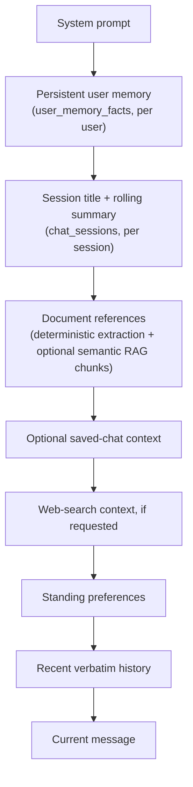
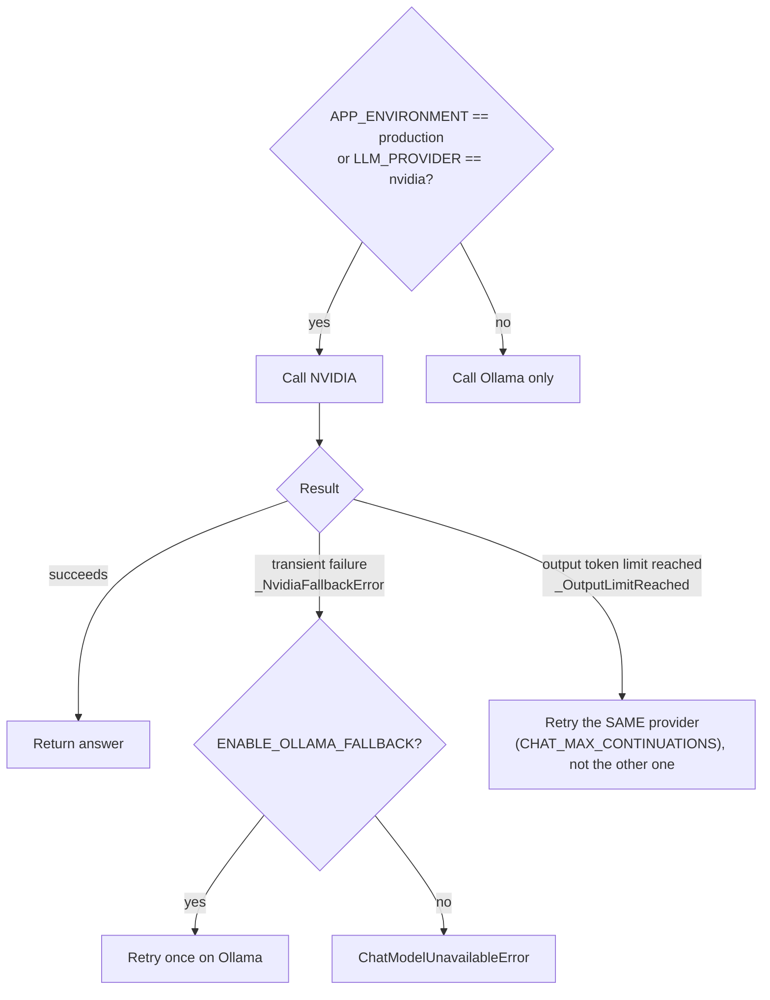
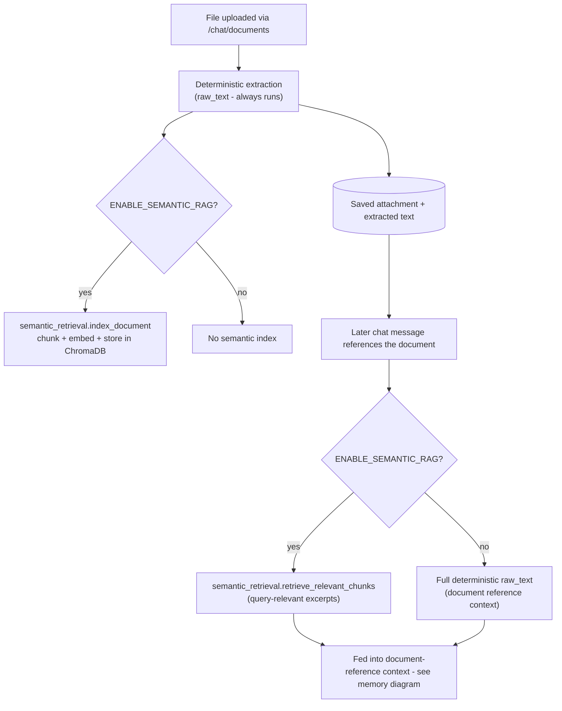

# Architecture overview

This document covers three subsystems that are easy to misunderstand from reading
one file at a time: the chat memory system, AI provider routing, and the document
upload/retrieval pipeline. It describes what the code actually does today, verified
against the implementation - if a behavior changes, update this alongside it rather
than letting it drift into aspiration.

## Chat memory system

Three layers combine into one assembled request, in `ChatService._build_request_body`
(`app/services/chat_service.py`):

1. **Persistent user memory** (`app/services/user_memory_service.py`,
   `user_memory_facts` table) - discrete facts a user explicitly states (allergy,
   dietary restriction, dislike, goal, cooking constraint), extracted with
   deterministic regex on every turn, no extra LLM call. Scoped to the *user*, so it
   survives across sessions instead of aging out of a per-session summary. Bounded
   at the source (max 8 facts per category, 1500-character block) rather than being
   trimmed by the token-budget pass, so it is never silently dropped.
2. **Rolling summary** (`app/services/chat_memory_service.py`,
   `chat_sessions.rolling_summary` + `summary_covers_through_message_id`) -
   scoped to one *session*. Once a session's visible history exceeds
   `ChatService.HISTORY_MESSAGE_LIMIT` (24 messages), a background task folds the
   turns falling out of that window into a running summary (capped at ~500 words /
   600 tokens), so detail is not lost outright, only compressed.
3. **Recent verbatim history and document references** - the last N messages and
   any relevant uploaded-document text, each with their own trimming so a large
   document retrieval cannot crowd out the sections above (see budget shares below).

PostgreSQL is the source of truth for all of the above. Redis
(`ENABLE_REDIS_CACHE`, default off) only caches the assembled recent-history list
for a session; every read/write degrades to a no-op and falls back to PostgreSQL
when Redis is disabled or unreachable - nothing depends on the cache being warm.

Messages are assembled in this fixed, labeled order:

Token budgeting (`CONTEXT_TOKEN_BUDGET`, default 24000 estimated tokens):
persistent user memory and the rolling summary are bounded at the source and always
included; document references and optional saved-chat context each get an explicit
share of the budget (`DOCUMENT_REFERENCE_TOKEN_BUDGET_SHARE` = 25%,
`OPTIONAL_REFERENCE_TOKEN_BUDGET_SHARE` = 10%) and are trimmed oldest-first if a
retrieval pulls in more than that; recent history gets whatever budget remains.

## AI provider routing

`ChatService` and `ChatVisionService` route between NVIDIA (hosted) and Ollama
(local) per `LLM_PROVIDER` and `APP_ENVIRONMENT`:

The token-limit case deliberately does not fall back to Ollama: `_OutputLimitReached`
is a distinct exception from `_NvidiaFallbackError`, and both providers share a
similar output-budget constraint, so switching providers would not fix a truncated
answer and would risk an inconsistent style mid-answer. `ENABLE_OLLAMA_FALLBACK` is
unset by default: enabled in development, disabled in production (a production
deployment with no local Ollama server would otherwise fail every request while
trying to fall back to it).

## Chat streaming protocol

`POST /chat/stream` returns newline-delimited JSON (NDJSON), not SSE. Each line is
one `{"type": ...}` object; clients ignore unrecognized types, so new types are
additive and safe for old frontends. In emission order:

1. `session` - the session id the turn is attached to (created on the first
   message of a conversation).
2. `meta` - `{session_id, user_message_id}`, emitted right after `session`. The
   user's message is already committed synchronously before streaming starts
   (`repository.add_message`), so this carries the real database id immediately
   instead of making the client wait for a polling refresh to learn it.
3. `status` (zero or one, optional) - `{stage: "searching"|"reading", detail}`,
   emitted when `ENABLE_WEB_SEARCH_SOURCE_CARDS` is on and the turn is about to
   search the web or read a linked page. A best-effort, single progress event
   (not a live multi-stage stream - the search call itself is one blocking
   call) predicted cheaply at the API layer before generation starts; its
   disappearance once `sources`/`token` arrive is the only "now answering"
   signal.
4. `sources` (zero or one, optional) - `{items, image_urls, search_query}`,
   emitted before the first `token` when the turn used the web and
   `ENABLE_WEB_SEARCH_SOURCE_CARDS` is on. `items` are structured source cards
   (title/url/domain/snippet); `image_urls` are deterministically vetted
   preview-image URLs (`app/services/web_image_preview.py` - HTTP range GET,
   header-parsed dimensions, aspect-ratio bounds, run concurrently), capped at
   2. The markdown "### Sources" footer is still appended to the answer text
   regardless, as the fallback rendering for old clients and already-saved
   messages.
5. `reasoning` (zero or more, optional) - a chunk of hidden model "thinking"
   (NVIDIA `reasoning_content` / Ollama `message.thinking`), tagged via the
   `ReasoningChunk` sentinel so it never enters `token` output, persisted
   answers, citations, or the continuation/no-progress accumulator.
6. `token` (zero or more) - a chunk of the visible answer.
7. `done` / `error` - terminal. `done` additionally carries `decision`,
   `intent`, `confidence`, and `escalated` when `ENABLE_TURN_GOVERNANCE` is on
   (omitted entirely when the flag is off, so the event stays byte-identical
   to before this existed).

Web search itself is hardened independently of whether source cards are on:
a Redis-backed daily cap (`WEB_SEARCH_DAILY_CAP`, fails open if Redis is
unreachable - "unmetered is better than unavailable") gates the actual
provider call (not direct link reads), and a deterministic phrase-list filter
(`app/services/web_search_safety.py`) blocks explicit-content queries before
searching and drops explicit results after - both apply whenever
`ENABLE_WEB_SEARCH` is on, regardless of `ENABLE_WEB_SEARCH_SOURCE_CARDS`.

Before `_build_request_body` assembles the three memory layers described above,
the request's `mode` field (a chat-profile name, see `app/services/chat_profiles.py`)
is resolved via `resolve_profile()` to a `ChatProfile` - unknown/missing modes
fall back to `general`. The profile picks the model, temperature, and whether
thinking/reasoning is requested for that turn; `LLM_PROFILE_OVERRIDES` can patch
any public profile's tuning without a code change.

**Pre-answer governance** (`app/services/turn_governance.py`, gated by
`ENABLE_TURN_GOVERNANCE`, off by default) runs first, before any of the above -
before the message even reaches `_build_request_body` or a provider. It is
deterministic (keyword/pattern matching, no LLM call) and classifies the turn
as `answer | clarify | block | escalate`. For anything other than `answer`, the
model is never called: the fixed reply for that decision is streamed as an
ordinary `token` and persisted as the bot message exactly like any other
answer, and the `done` event's `decision`/`intent`/`confidence`/`escalated`
fields tell the frontend to show a small, dismissible badge. It reuses
`conversation_guidance.is_personal_conversation` for the ordinary `answer`
path's `intent` label rather than duplicating a second classifier.

## Document pipeline

Deterministic extraction always runs and is what document Q&A and generation rely
on by default; semantic indexing/retrieval is strictly additive and never a
replacement for it. If Chroma or the embedding provider (`EMBEDDING_PROVIDER`,
`nvidia` with an Ollama fallback, or `ollama`) is unreachable, retrieval falls back
to the deterministic raw-text path rather than failing the request.
