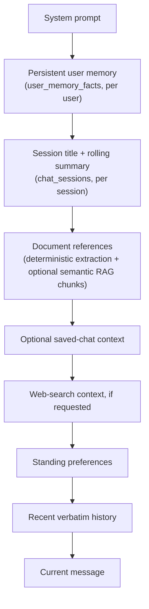
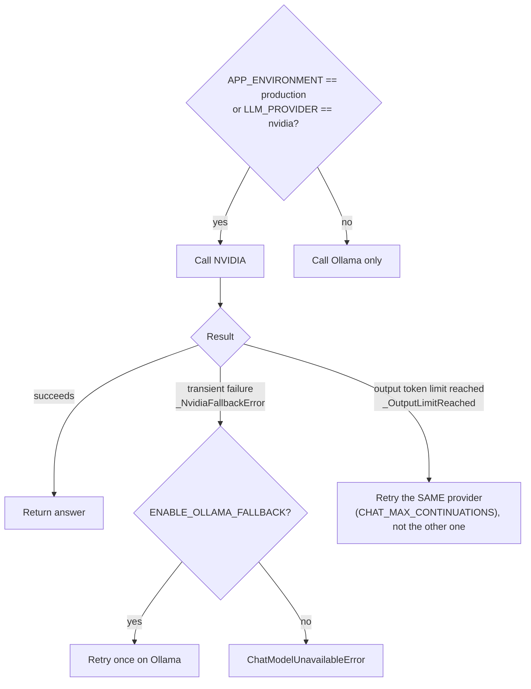
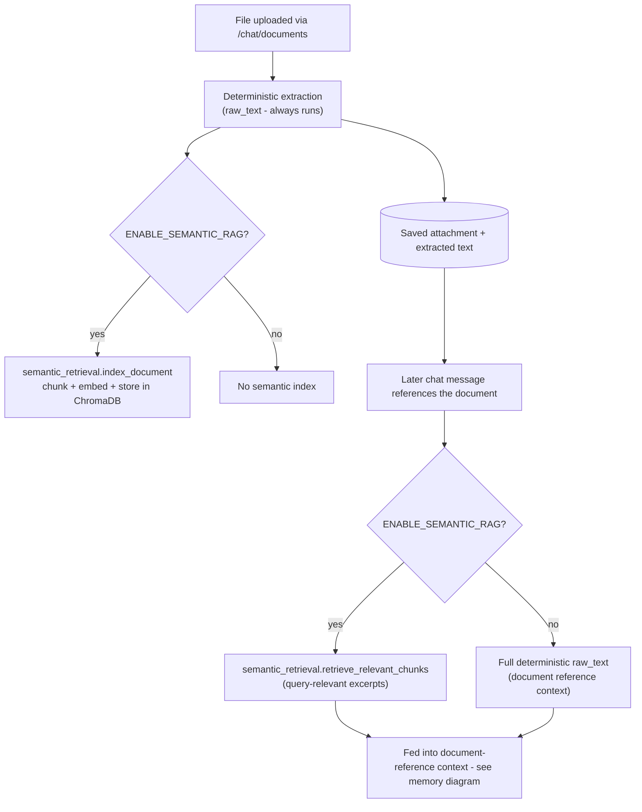

# Architecture overview

This document covers three subsystems that are easy to misunderstand from reading
one file at a time: the chat memory system, AI provider routing, and the document
upload/retrieval pipeline. It describes what the code actually does today, verified
against the implementation - if a behavior changes, update this alongside it rather
than letting it drift into aspiration.

## Chat memory system

Three layers combine into one assembled request, in `ChatService._build_request_body`
(`app/services/chat_service.py`):

1. **Persistent user memory** (`app/services/user_memory_service.py`,
   `user_memory_facts` table) - discrete facts a user explicitly states (allergy,
   dietary restriction, dislike, goal, cooking constraint), extracted with
   deterministic regex on every turn, no extra LLM call. Scoped to the *user*, so it
   survives across sessions instead of aging out of a per-session summary. Bounded
   at the source (max 8 facts per category, 1500-character block) rather than being
   trimmed by the token-budget pass, so it is never silently dropped.
2. **Rolling summary** (`app/services/chat_memory_service.py`,
   `chat_sessions.rolling_summary` + `summary_covers_through_message_id`) -
   scoped to one *session*. Once a session's visible history exceeds
   `ChatService.HISTORY_MESSAGE_LIMIT` (24 messages), a background task folds the
   turns falling out of that window into a running summary (capped at ~500 words /
   600 tokens), so detail is not lost outright, only compressed.
3. **Recent verbatim history and document references** - the last N messages and
   any relevant uploaded-document text, each with their own trimming so a large
   document retrieval cannot crowd out the sections above (see budget shares below).

PostgreSQL is the source of truth for all of the above. Redis
(`ENABLE_REDIS_CACHE`, default off) only caches the assembled recent-history list
for a session; every read/write degrades to a no-op and falls back to PostgreSQL
when Redis is disabled or unreachable - nothing depends on the cache being warm.

Messages are assembled in this fixed, labeled order:

Token budgeting (`CONTEXT_TOKEN_BUDGET`, default 24000 estimated tokens):
persistent user memory and the rolling summary are bounded at the source and always
included; document references and optional saved-chat context each get an explicit
share of the budget (`DOCUMENT_REFERENCE_TOKEN_BUDGET_SHARE` = 25%,
`OPTIONAL_REFERENCE_TOKEN_BUDGET_SHARE` = 10%) and are trimmed oldest-first if a
retrieval pulls in more than that; recent history gets whatever budget remains.

## AI provider routing

`ChatService` and `ChatVisionService` route between NVIDIA (hosted) and Ollama
(local) per `LLM_PROVIDER` and `APP_ENVIRONMENT`:

The token-limit case deliberately does not fall back to Ollama: `_OutputLimitReached`
is a distinct exception from `_NvidiaFallbackError`, and both providers share a
similar output-budget constraint, so switching providers would not fix a truncated
answer and would risk an inconsistent style mid-answer. `ENABLE_OLLAMA_FALLBACK` is
unset by default: enabled in development, disabled in production (a production
deployment with no local Ollama server would otherwise fail every request while
trying to fall back to it).

## Document pipeline

Deterministic extraction always runs and is what document Q&A and generation rely
on by default; semantic indexing/retrieval is strictly additive and never a
replacement for it. If Chroma or the embedding provider (`EMBEDDING_PROVIDER`,
`nvidia` with an Ollama fallback, or `ollama`) is unreachable, retrieval falls back
to the deterministic raw-text path rather than failing the request.
